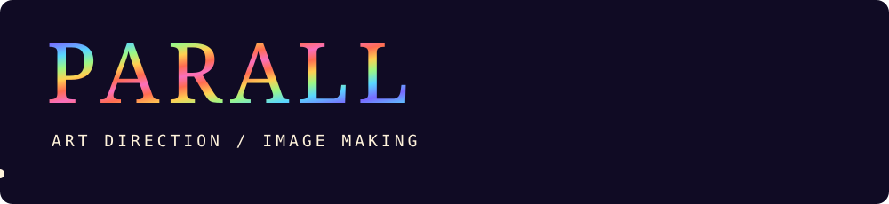
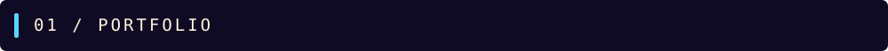
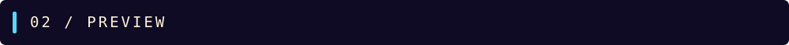
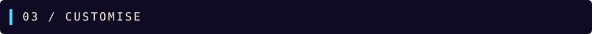
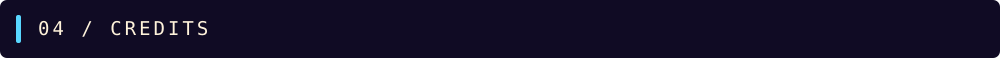

# Parall Portfolio

A one-page creative portfolio with six featured studies, a three-stage process, a seven-frame archive and a direct route to enquiries. The sample studio is fictional; its images are stock photography used as sample content.

## Portfolio

- Full-screen typographic hero and thermal photo treatment
- Scroll-driven type and image reveals, pinned archive on supported viewports, and reduced-motion layouts
- Responsive header and menu, native FAQ accordions, and service links that prefill the enquiry subject
- Plain HTML, layered CSS, SVG, GSAP, ScrollTrigger and Lenis. No framework, build step or third-party requests at runtime

## Preview

Open `index.html` from the extracted folder, or serve the folder using `python -m http.server 8000` and visit `http://localhost:8000/`. For GitHub Pages, upload the site files at the repository root, then publish from `main` → `/(root)` under **Settings → Pages**.

## Customise

| File             | What to change                                                               |
| ---------------- | ---------------------------------------------------------------------------- |
| `index.html`     | Name, section copy, work, service names, contact address and image alt text  |
| `style.css`      | Theme tokens, typography, layouts and breakpoints                            |
| `motion.js`      | Scroll scenes, mobile navigation and email draft behaviour                   |
| `assets/images/` | Demo photography; preserve filenames or update both image layers in the HTML |

Replace all instances of `studio@example.com` before sharing. The form opens a draft in the visitor’s mail client; it does not submit to a server. README graphics use standalone SVG animation and remain readable if a client shows them as stills.

## Credits and rights

Layout and motion adapted from [Kelvin](https://kelvin.8b.com/). The reference’s public availability does not grant a redistribution license. **Confirm permission for the adapted layout and code before publishing this as a public template.** This repository does not grant a blanket license over the reference, photography, fonts, or bundled libraries.

See [asset credits](ASSET-CREDITS.md) for original photo links and third-party terms. GSAP and ScrollTrigger are subject to the [GSAP license](https://gsap.com/standard-license/); Lenis is [MIT licensed](https://github.com/darkroomengineering/lenis/blob/main/LICENSE). Hubot Sans and Kalnia use the SIL Open Font License.
